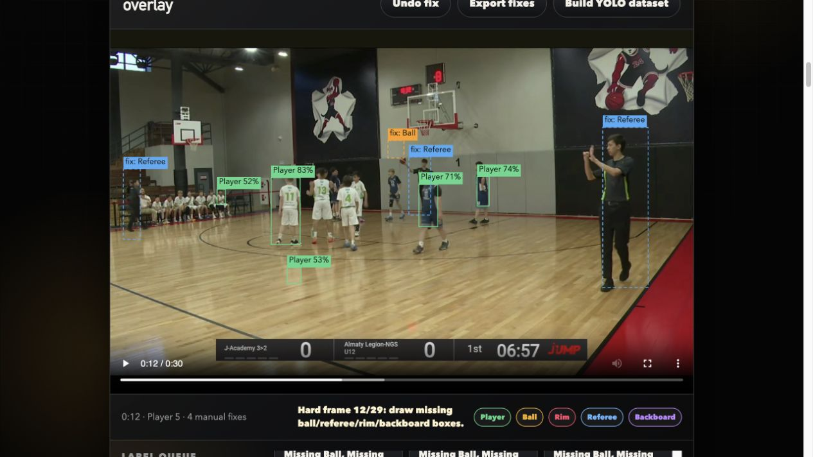
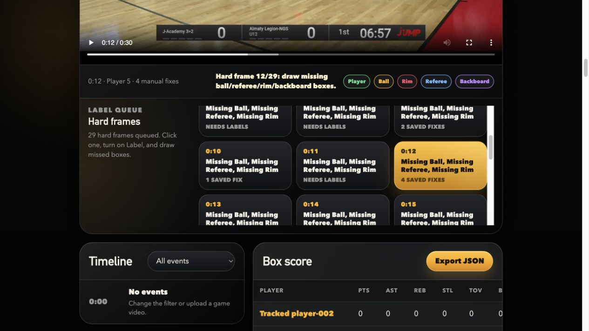
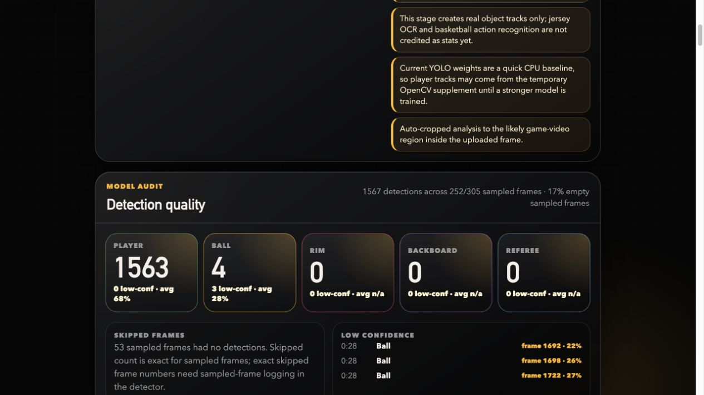

# Basketball AI Tracker

An AI-assisted workflow for turning basketball game video into reviewable detections, tracks, corrections, and eventually timestamped player statistics.

The project is deliberately human-in-the-loop. A trained detector proposes players, balls, rims, backboards, and referees; the browser overlay lets a reviewer inspect or correct those boxes; corrections can then be exported as YOLO labels for the next training cycle.

> **Project status:** detection and tracking MVP. Automatic assists, rebounds, turnovers, and jersey identity are roadmap items, not finished features.

## Product Walkthrough

### Video Detection Overlay

Real model detections and saved corrections are drawn directly over the uploaded game video. Solid boxes are model output; dashed `fix:` boxes are reviewer corrections.



### Correction Workflow

The hard-frame sampler queues weak moments, reports missing classes, and shows how many fixes have already been saved at each timestamp.



### Detection Quality Report

The browser report exposes per-class counts, empty sampled frames, and low-confidence detections so training work can target the largest gaps.



## What Works Today

- Upload and play basketball video in the browser.
- Run a modular YOLO/OpenCV vision pipeline.
- Store frame numbers, timestamps, classes, confidence scores, boxes, and temporary track IDs.
- Review raw detections or tracks as a video overlay.
- Draw correction boxes for `player`, `ball`, `rim`, `backboard`, and `referee`.
- Export saved corrections as exact video frames plus YOLO label files.
- Sample hard frames where the detector is missing objects or has low confidence.
- Report per-class counts, skipped frames, and low-confidence detections.
- Compare detector quality before and after training.
- Aggregate confirmed event records into a timestamped box-score schema.

## Current Detector Baseline

The current promoted local checkpoint was evaluated on the clean E-BARD four-class validation split at `imgsz=960`:

| Class | Precision | Recall | mAP50 | mAP50-95 |
| --- | ---: | ---: | ---: | ---: |
| ball | 0.776 | 0.693 | 0.745 | 0.334 |
| rim | 0.955 | 0.981 | 0.991 | 0.609 |
| player | 0.954 | 0.926 | 0.972 | 0.776 |
| referee | 0.907 | 0.930 | 0.950 | 0.715 |

Model weights, game videos, private corrections, and dataset images are intentionally not committed to Git. Put a compatible checkpoint at `models/basketball-detector.pt`, or run the app without it to use the fallback analyzer.

## Architecture

```text
Browser UI
  -> FastAPI upload/job API
  -> VideoAnalyzer interface
  -> YOLO/OpenCV detector
  -> lightweight tracker
  -> detections/tracks JSON
  -> review + correction UI
  -> YOLO correction exporter
```

## Run Locally

```bash
python3 -m venv .venv
source .venv/bin/activate
pip install -e ".[dev]"
uvicorn basketball_ai_tracker.api.main:app --reload
```

Open `http://127.0.0.1:8000`, upload a video, and the analyzer will return player/ball tracks plus the stat/result JSON contract.

If you prefer not to activate the environment:

```bash
.venv/bin/python -m pip install -e ".[dev]"
.venv/bin/uvicorn basketball_ai_tracker.api.main:app --host 127.0.0.1 --port 8000
```

For real video detection and tracking:

```bash
pip install -e ".[dev,cv]"
```

For detector training:

```bash
pip install -e ".[train,dev]"
```

## Verify

```bash
.venv/bin/python -m pytest
```

## Current MVP

- Upload a basketball video from the browser.
- Create an analysis job and poll until complete.
- Detect basketball objects with YOLO when compatible weights are available, with an OpenCV fallback.
- Show detection boxes and track IDs with first/last seen time, observation count, and confidence.
- Review and correct detections directly over the uploaded video.
- Export corrections and hard frames into retraining-ready datasets.
- Generate detection-quality reports for the five target classes.
- Emit timestamped event/stat JSON through the existing contract.
- Aggregate events into a player box score.
- Export the full JSON result.

The browser app uses the trained YOLO detector when compatible weights and Ultralytics are installed. It can fall back to OpenCV or the deterministic demo analyzer when those dependencies are unavailable.

## Run Vision Detector

```bash
.venv/bin/python scripts/run_vision.py storage/uploads/example.mov --sample-fps 4 --max-frames 300
```

For a full JSON artifact:

```bash
.venv/bin/python scripts/run_vision.py storage/uploads/example.mov --output storage/results/example-vision.json
```

## Train Object Detector

Use internet media only when you own it, have permission, or the license allows training use. Do not scrape random search results into a dataset.

Good first data sources:

- Your own uploaded game videos.
- Open/public datasets with clear licenses.
- Roboflow Universe datasets exported in YOLO format.
- COCO/Open Images for bootstrapping generic `person` and `sports ball` classes.

Target classes for this project:

```text
0 player
1 ball
2 rim
3 backboard
4 referee
```

1. Put permitted media URLs or local files in a source list.

```bash
cp datasets/basketball/sources.example.txt datasets/basketball/sources.txt
```

2. Extract training frames.

```bash
.venv/bin/python scripts/collect_training_media.py \
  --sources datasets/basketball/sources.txt \
  --frame-step-seconds 1 \
  --max-frames-per-video 400
```

3. Label the frames.

Use CVAT, Roboflow, Label Studio, or another labeling tool. Export labels in YOLO detection format into:

```text
datasets/basketball/labels/train
datasets/basketball/labels/val
```

You can bootstrap rough `player` and `ball` labels with a pretrained YOLO model:

```bash
.venv/bin/python scripts/pseudo_label_yolo.py --confidence 0.35
```

Review pseudo-labels before serious training. They will miss small balls and will not label `rim`, `backboard`, or `referee` reliably.

## Merge YOLO Datasets

If you have multiple YOLO/Roboflow exports, merge them into the project dataset with:

```bash
.venv/bin/python scripts/merge_yolo_datasets.py \
  /path/to/dataset_1 \
  /path/to/dataset_2 \
  /path/to/dataset_3 \
  /path/to/dataset_4 \
  --output datasets/basketball
```

The merge script reads each dataset's `data.yaml`, remaps common class names to this project's class IDs, and writes merged files into:

```text
datasets/basketball/images/train
datasets/basketball/images/val
datasets/basketball/labels/train
datasets/basketball/labels/val
```

Supported target classes are:

```text
0 player
1 ball
2 rim
3 backboard
4 referee
```

4. Train.

```bash
.venv/bin/python scripts/train_detector.py \
  --data configs/basketball-detector.yaml \
  --model yolo11n.pt \
  --epochs 100 \
  --imgsz 960 \
  --batch 8
```

The script copies the best weights to:

```text
models/basketball-detector.pt
```

5. Run the app with trained weights.

If `models/basketball-detector.pt` exists and `ultralytics` is installed, the app will use it automatically. You can also point to a different model:

```bash
BASKETBALL_YOLO_WEIGHTS=/absolute/path/to/best.pt \
  .venv/bin/uvicorn basketball_ai_tracker.api.main:app --host 127.0.0.1 --port 8000
```

The YOLO detector supports a lower ball-only confidence threshold so small/blurred balls are less likely to be skipped while player, rim, and referee detections keep the normal threshold:

```bash
BASKETBALL_YOLO_CONF=0.15 BASKETBALL_YOLO_BALL_CONF=0.08 \
  .venv/bin/uvicorn basketball_ai_tracker.api.main:app --host 127.0.0.1 --port 8000
```

## Install External Detector Weights

If you obtain a third-party or separately trained Ultralytics YOLO `.pt` model, inspect its classes before replacing the app detector:

```bash
.venv/bin/python scripts/install_external_detector.py /path/to/external-best.pt
```

Install compatible weights into the app:

```bash
.venv/bin/python scripts/install_external_detector.py /path/to/external-best.pt \
  --install \
  --overwrite
```

The installer maps common basketball class names such as `basketball player`, `basketball`, `basketball hoop`, and `official` into the app classes:

```text
player, ball, rim, backboard, referee
```

After installing weights, restart the server so the analyzer loads the new model.

## Public Basketball Model Transfer Learning

The project can bootstrap from the public E-BARD YOLOv8n basketball detector hosted on Hugging Face.
That model is licensed `cc-by-4.0` and detects:

```text
basketball, hoop, player, referee
```

Those map into this app as:

```text
basketball -> ball
hoop -> rim
player -> player
referee -> referee
```

It does not include `backboard`, so use it as transfer-learning weights and fine-tune on this project's 5-class dataset.

Prepare the public model:

```bash
.venv/bin/python scripts/prepare_public_basketball_models.py
```

Then fine-tune our 5-class detector from those weights:

```bash
.venv/bin/python scripts/train_detector.py \
  --data configs/basketball-detector.yaml \
  --model models/external/ebard-yolov8n-bodd.pt \
  --epochs 100 \
  --imgsz 1280 \
  --batch 8 \
  --name basketball-detector-ebard-transfer \
  --export-to models/basketball-detector.pt
```

The `goldensquirrel11/basketball-hoop-tracker` repository is useful as a reference for YOLO hoop-training utilities, frame extraction, pseudo-labeling, and video prediction workflows. The repository itself does not publish a ready detector dataset or weights, so it is not merged automatically.

## Export Review Corrections to YOLO

The correction labeling tool saves manual boxes in `storage/corrections/{game_id}.json`.
Export those corrections into a YOLO dataset before retraining:

```bash
.venv/bin/python scripts/export_corrections_to_yolo.py \
  --game-id YOUR_GAME_ID \
  --output datasets/basketball-corrections
```

To export every saved correction file that still has a matching uploaded video:

```bash
.venv/bin/python scripts/export_corrections_to_yolo.py \
  --all \
  --output datasets/basketball-corrections
```

The exporter creates:

```text
datasets/basketball-corrections/
  data.yaml
  images/train/*.jpg
  labels/train/*.txt
```

Each `.txt` file uses YOLO normalized labels in this class order:

```text
0 player
1 ball
2 rim
3 backboard
4 referee
```

## Export Hard Frames for Labeling

Use the hard-frame exporter to collect frames where the current detector is weak.
This is useful for improving small/rare classes such as `ball`, `referee`, `rim`, and `backboard`.

```bash
.venv/bin/python scripts/export_hard_frames.py \
  --game-id YOUR_GAME_ID \
  --output datasets/basketball-hard-frames \
  --classes ball,referee,rim,backboard \
  --max-frames 80
```

The exporter creates:

```text
datasets/basketball-hard-frames/
  data.yaml
  images/train/*.jpg
  labels/train/*.txt
  metadata/YOUR_GAME_ID-hard-frames.json
```

The generated `.txt` label files are intentionally empty placeholders.
Label these frames before using this folder for training; otherwise YOLO will treat them as negative examples.
The metadata file explains why each frame was selected, for example missing ball, missing referee, or low-confidence ball.

## Detection Quality Reports

After a video analysis completes, the app shows a detection quality report with:

- per-class counts for `player`, `ball`, `rim`, `backboard`, and `referee`
- sampled frames with no detections
- low-confidence detections grouped by class
- example low-confidence timestamps for review

Fetch the report as JSON:

```bash
curl http://127.0.0.1:8000/api/games/YOUR_GAME_ID/quality
```

Compare detector quality before and after retraining by passing two saved result JSON files:

```bash
.venv/bin/python scripts/compare_detection_quality.py \
  --before storage/results/BEFORE_GAME_OR_RUN.json \
  --after storage/results/AFTER_GAME_OR_RUN.json
```

Use `--json` for machine-readable output.

## Project Structure

```text
src/basketball_ai_tracker/
  analyzers/        AI/video analyzer implementations
  api/              FastAPI upload and result endpoints
  services/         stats aggregation, serialization, jobs
  vision/           detector, tracker, quality report, correction export
  models.py         player, event, stat, and result data models
web/                browser UI
scripts/            training, evaluation, mining, and dataset helpers
tests/              API, detector, tracker, exporter, and utility tests
storage/            local uploads/results/corrections (Git-ignored)
datasets/           local training data (Git-ignored)
models/             local weights and runs (Git-ignored)
```

## API Shape

- `POST /api/games`: upload a video file.
- `GET /api/games/{game_id}`: get job status and completed result.
- `GET /api/games/{game_id}/stats`: get player box score.
- `GET /api/games/{game_id}/events`: get timestamped events.

## Roadmap

1. Stabilize detector quality
   Improve small-ball recall and add enough labeled backboard examples while preserving player, rim, and referee quality.

2. Upgrade tracking quality
   Replace the lightweight tracker with ByteTrack, BoT-SORT, or a similar tracker after detections are stable and sufficiently frequent.

3. Jersey and team identification
   Crop tracked players, classify team by uniform color, and read jersey numbers with OCR or a custom jersey-number recognizer. Add a review screen for uncertain identities because motion blur and occlusion are common.

4. Event detection
   Combine ball trajectory, player tracks, court zones, pose signals, and temporal video models to detect shots, rebounds, turnovers, steals, blocks, and fouls. Assists are especially contextual, so the first production version should support human confirmation.

5. Stat validation workflow
   Present low-confidence clips for review. A practical product should let a human accept, edit, or reject events before finalizing stats.

6. Dataset loop
   Store corrected events as training labels. Each reviewed game should improve the next model.

## Data Contract

Every detected moment is stored as a `StatEvent` with:

- `event_type`: basketball stat event, for example `assist` or `three_pointer_made`.
- `player_id`: stable identity for the credited player.
- `video_time_seconds`: timestamp in the uploaded video.
- `timecode`: formatted video moment such as `1:49`.
- `related_player_ids`: connected players, for example assister/scorer or stealer/turnover player.
- `confidence`: model confidence for review and filtering.

This gives the final table and the exact video moments behind the table.
